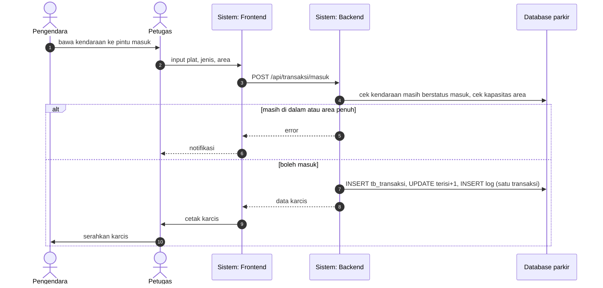
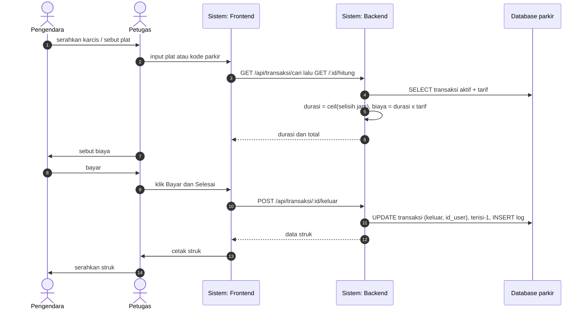
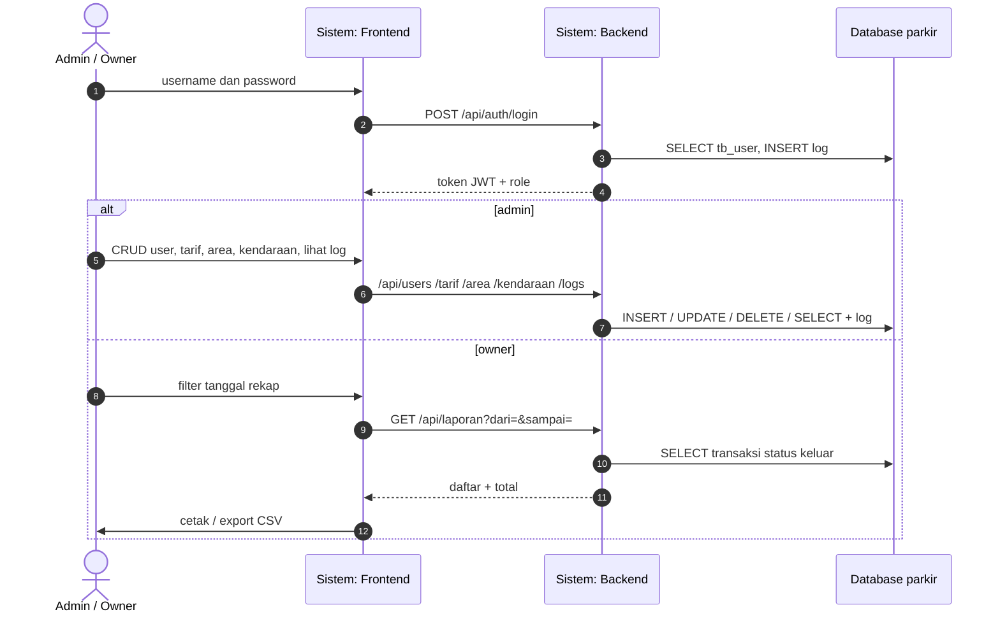
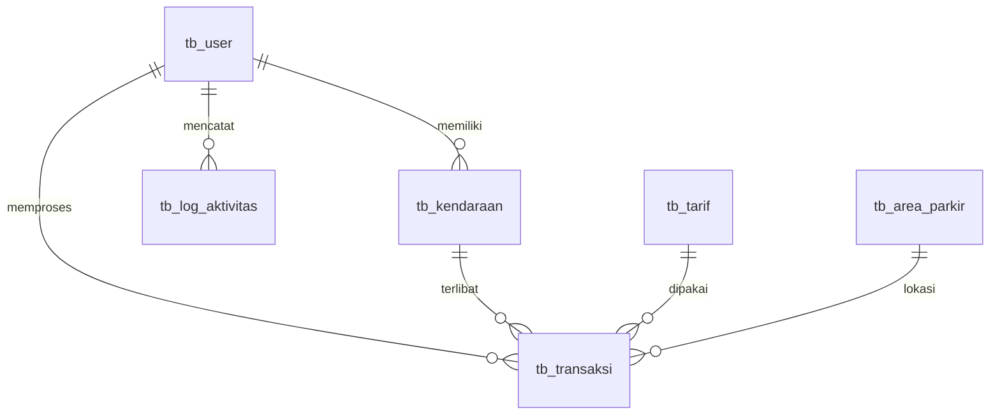
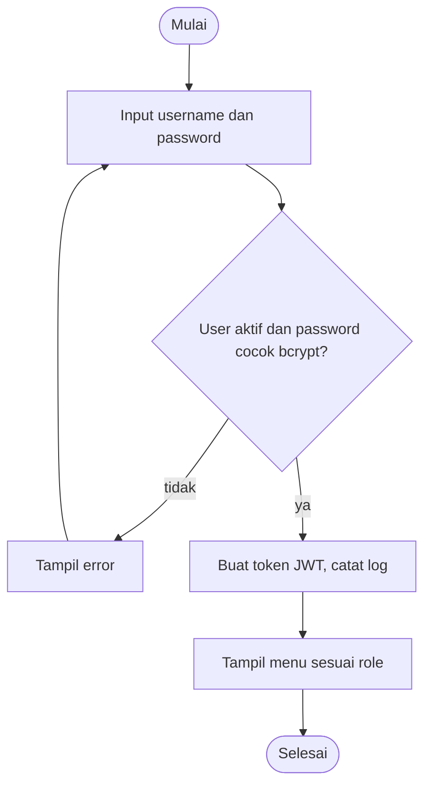
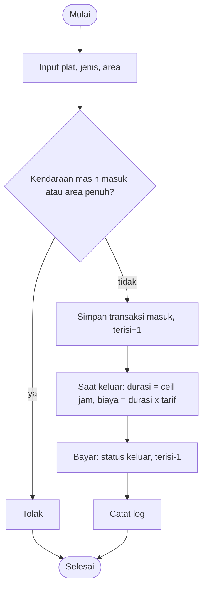
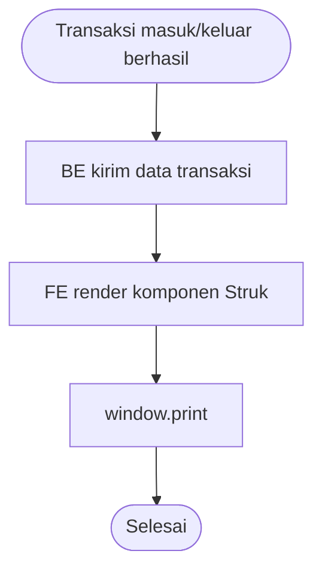

# Swimlane, Barrier, dan Dokumentasi — Aplikasi Parkir
> Dibuat dengan bantuan Antigravity CLI (Claude Sonnet). Acuan: SPK Paket 2 UKK RPL 2025/2026 ([SPK_II_referensi.md](SPK_II_referensi.md)).

## 1. Barrier FE / BE
| Aturan | Isi |
|---|---|
| Satu-satunya kontak | HTTP JSON ke `/api/*`. FE hanya lewat `frontend/src/api.js`. |
| Tidak berbagi kode | `frontend/` dan `backend/` punya `package.json` dan `node_modules` sendiri. Tidak ada import silang. |
| Akses DB | Hanya BE yang bicara ke MySQL. |
| Aturan bisnis di BE | Biaya, kapasitas, cek role. FE hanya menampilkan. |
| Konfigurasi | FE: `VITE_API_URL`. BE: `.env`. |

## 2. Swimlane (4 lane sesuai SPK: Pengendara, Petugas, Sistem [FE+BE], Database)
### A. Kendaraan masuk dan cetak karcis

### B. Kendaraan keluar dan cetak struk

### C. Admin dan Owner

## 3. ERD

## 4. Flowchart (a) login, (b) transaksi, (c) struk

## 5. Dokumentasi modul (input, proses, output)
| Modul | Input | Proses | Output |
|---|---|---|---|
| `POST /auth/login` | username, password | cek tb_user, bcrypt.compare, jwt.sign | token, user |
| `auth(...roles)` | header Bearer token | verifikasi JWT dan role | lanjut / 401 / 403 |
| `crud()` | body sesuai tabel | INSERT/UPDATE/DELETE/SELECT + log | data / id |
| `POST /transaksi/masuk` | plat, jenis, warna, pemilik, id_area | validasi, transaksi atomik | data karcis |
| `GET /transaksi/cari` | q (plat/kode) | cari transaksi status masuk | id_parkir |
| `hitung()` | id_parkir | durasi ceil jam, biaya = jam x tarif | durasi, biaya |
| `POST /transaksi/:id/keluar` | id_parkir | update transaksi dan area, log | data struk |
| `GET /laporan` | dari, sampai | SELECT status keluar | total, daftar |
| FE `api()` | path, method, body | fetch + header JWT | JSON / throw Error |
| FE `Struk` | jenis, data | render + window.print | struk tercetak |

## 6. Pembagian kerja
| Lane | Tugas | Pelaksana |
|---|---|---|
| BE | skema DB, API, auth | Worker (Argon Medium) |
| FE | halaman React | Worker (Argon Medium) |
| Review dan integrasi | cek kontrak, gabung repo | Bos (Sonnet Medium) |
