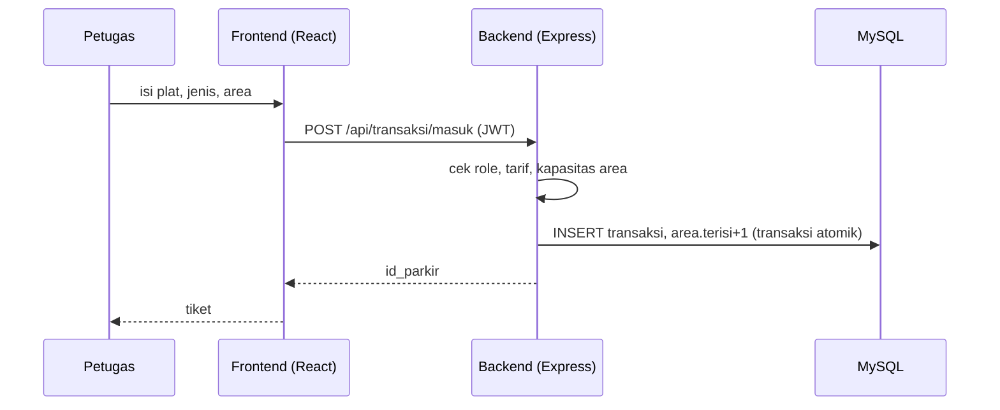
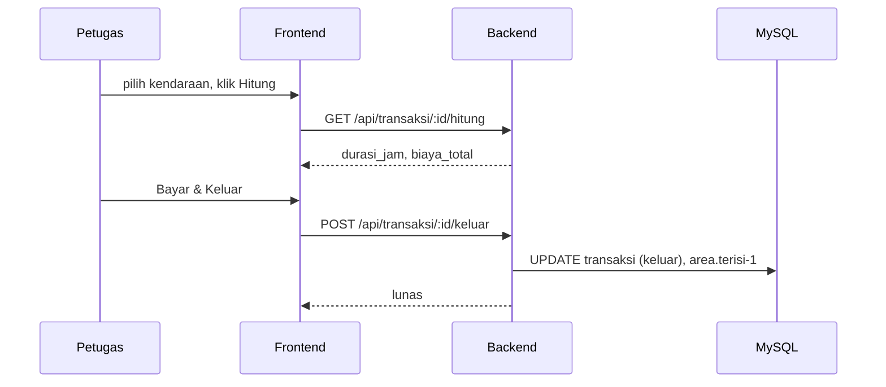

# Swimlane & Barrier FE / BE — Aplikasi Parkir
> Dokumen ini dibuat dengan bantuan Antigravity CLI (Claude Sonnet). Acuan: SPK Paket 2 UKK RPL 2025/2026.

## Barrier (batas FE dan BE)
| Aturan | Isi |
|---|---|
| Satu-satunya kontak | HTTP JSON ke `/api/*`. FE hanya lewat `frontend/src/api.js`. |
| Tidak berbagi kode | `frontend/` dan `backend/` punya `package.json` dan `node_modules` sendiri. Tidak ada import silang. |
| Tidak berbagi akses DB | Hanya BE yang bicara ke MySQL. FE tidak tahu skema. |
| Aturan bisnis di BE | Biaya parkir, kapasitas area, dan cek role dihitung di BE. FE hanya menampilkan. |
| Konfigurasi | FE: `VITE_API_URL`. BE: `.env` (DB, JWT, CORS). |

## Swimlane: Kendaraan Masuk

## Swimlane: Kendaraan Keluar

## Swimlane: Admin dan Owner
- Admin: CRUD `/api/users`, `/api/tarif`, `/api/area`, `/api/kendaraan`, lihat `/api/logs`.
- Owner: `GET /api/laporan?dari=&sampai=` (rekap pendapatan).

## Kontrak API
| Method | Path | Role |
|---|---|---|
| POST | /auth/login | publik |
| GET/POST/PUT/DELETE | /users, /tarif, /area | GET semua role login; tulis admin |
| GET/POST/PUT/DELETE | /kendaraan | tulis admin, petugas |
| POST | /transaksi/masuk | admin, petugas |
| GET | /transaksi?status=masuk | login |
| GET | /transaksi/:id/hitung | admin, petugas |
| POST | /transaksi/:id/keluar | admin, petugas |
| GET | /laporan | admin, owner |
| GET | /logs | admin |

## Pembagian kerja
| Lane | Tugas | Pelaksana |
|---|---|---|
| BE | skema DB, API, auth | Worker (Argon Medium) |
| FE | halaman React | Worker (Argon Medium) |
| Review & integrasi | cek kontrak, gabung repo | Bos (Sonnet Medium) |
